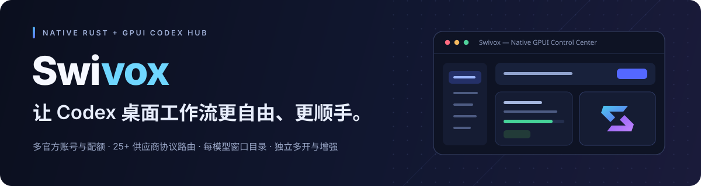
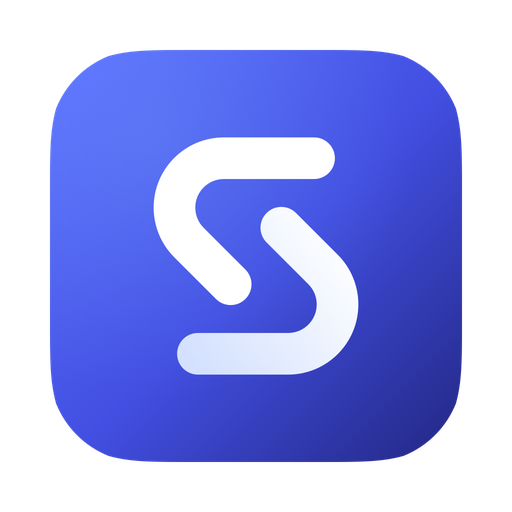

<p align="center">
  
</p>

<p align="center">
  <strong>让 Codex 与 Antigravity 桌面应用更自由、更顺手。</strong><br>
  基于原生 Rust + GPUI 构建的多官方账号、Antigravity 一等公民接管、Lamplighter 多服务额度监控与 5h 自动点火、第三方 API 供应商路由、每模型上下文目录与工作流增强中心。
</p>

<p align="center">
  <a href="https://github.com/aurorax-neo/swivox/releases"></a>
  <a href="https://github.com/aurorax-neo/swivox/stargazers"></a>
  <a href="LICENSE"></a>
  
  
</p>

<p align="center">
  <a href="https://github.com/aurorax-neo/swivox/releases"><strong>下载最新版 ↗</strong></a> &nbsp; · &nbsp;
  <a href="#功能一览">功能一览</a> &nbsp; · &nbsp;
  <a href="#快速上手">快速上手</a> &nbsp; · &nbsp;
  <a href="#官方账号与供应商模式">账号与供应商模式</a> &nbsp; · &nbsp;
  <a href="https://github.com/aurorax-neo/swivox/issues">反馈问题</a> &nbsp; · &nbsp;
  <a href="README_EN.md">English</a>
</p>

**Swivox** 是面向 OpenAI Codex / ChatGPT 与 Google Antigravity 桌面应用的原生 GPU 加速管理与增强工具，全栈采用 **Rust + GPUI** 构建（无 WebView 内存开销，常驻内存约 50MB）。通过 CDP、本地协议转换代理与后台调度引擎，一站式提供多官方账号切换、Antigravity 无感热切号与免 TUN 代理启动、Lamplighter（点灯人）多服务额度监控与 5 小时窗口重置自动点火、25+ 预设 API 供应商与聚合路由、每模型上下文窗口声明、独立实例多开、MCP / Skills / 会话管理及渲染层增强，无需篡改官方应用的 `app.asar` 或 `.app` 签名，且状态目录（`~/.swivox`）与本地服务端口（`58318–58321`）完全独立隔离。

## 功能一览

<table>
  <tr>
    <td width="50%" valign="top">
      <h3>👤 Codex 多官方账号与实时配额</h3>
      支持 OAuth PKCE 浏览器登录、手动回调解析、从本机 <code>auth.json</code> / macOS Keychain 导入及 JSON 批量导入导出；支持查询 5 小时 / 周 / 月实时配额、Token 自动续期与免重登切换，并可按账号独立绑定任意第三方 API 供应商。
    </td>
    <td width="50%" valign="top">
      <h3>🪐 Antigravity 一等公民接管</h3>
      支持个人与企业 GCP 双客户端 OAuth 登录、Cloud Code Private 三端点配额查询（<code>Gemini</code> / <code>Claude &amp; GPT</code> / <code>Gemini 4 Argon</code> 双窗口进度与等级识别）、<strong>Desktop 无感热切号</strong>（仅重载 <code>language_server</code> 保留窗口）、单账号设备指纹隔离、<strong>免 TUN 代理启动</strong>、3,376 词条可逆 CDP 汉化与实时上下文圆环。
    </td>
  </tr>
  <tr>
    <td valign="top">
      <h3>🏮 Lamplighter（点灯人）自动点火与监控</h3>
      零配置自动汇聚 Swivox 自有 Codex 官方账号与 Antigravity 账号，同时支持 Claude / Kimi / Grok 及外部 CLIProxyAPI (CPA)；提供 <strong>5 小时窗口重置自动点火</strong>（<code>07:00–22:30</code> 时段、7d 耗尽保护、退避熔断与手动立即点火）、加权趋势曲线与耗尽预测、Bark / 飞书 / 钉钉 / Telegram / ntfy 推送及本地脱敏 <code>127.0.0.1:58318/mcp</code> 服务。
    </td>
    <td valign="top">
      <h3>🔌 纯 API、协议转换与聚合路由</h3>
      内置 DeepSeek、GLM、Kimi、Qwen、OpenRouter 等 25 个供应商预设，支持纯 API 供应商、故障转移池与模型聚合；内置 Chat Completions ⇄ Responses 协议代理、跨供应商加密推理项自动清洗与 Provider Doctor 诊断。
    </td>
  </tr>
  <tr>
    <td valign="top">
      <h3>🧵 Codex 独立实例多开 &amp; 每模型目录</h3>
      支持以任意「官方账号」或「API 供应商」身份一键拉起完全隔离的 Codex 实例；支持通过 <code>deepseek-v4-pro[1M]</code> 语法或可视化表格为每个模型独立配置上下文窗口（128k–2M）、自动压缩阈值与图片策略。
    </td>
    <td valign="top">
      <h3>✨ 客户端增强、MCP / Skills 与缓存清理</h3>
      全局零偏移浮动 Toast 通知、托管同步 <code>config.toml</code> MCP 与 GitHub Skills、会话安全归档删除、云端 Whisper 与离线 SenseVoiceSmall 语音听写、下一步追问建议（Stepwise）、自定义壁纸图层与 AI Agent 缓存白名单清理。
    </td>
  </tr>
</table>

## 快速上手

### 1. 下载安装

前往 [GitHub Releases](https://github.com/aurorax-neo/swivox/releases) 下载对应平台安装包：

| 平台与架构 | 安装包 |
| --- | --- |
| macOS · Apple Silicon (M 系列) | `Swivox-*-macos-arm64.dmg` |
| macOS · Intel (x64) | `Swivox-*-macos-x64.dmg` |
| Windows · x64 | `Swivox-*-windows-x64-setup.exe` / `Swivox-*-windows-x64.zip` |

首次启动前请确认本机已安装官方 Codex / ChatGPT 桌面应用。

### 2. 配置账号或供应商

打开 **Swivox**：
- **官方账号模式**：在「官方账号」页通过 OAuth 登录或读取本机登录；可直接使用纯官方配额，也可在卡片右下角绑定第三方 API 供应商。
- **纯 API / 聚合供应商模式**：在「供应商配置」页从 25 个内置预设一键创建或新建自定义/故障转移/模型聚合配置，点击「使用」即可选择「仅使用（重启生效）」或「使用并重启 Codex」。

### 3. 启动、接管与多开

- **主实例控制**：通过顶栏「启动 Codex」、「停止 Codex」、「重启 Codex」管理主实例；也可在「安装维护」页开启官方 Codex App 自动接管。
- **多实例隔离**：进入「Codex多开」页，按官方账号或供应商身份并行启动多个互不干扰的 Codex 窗口。

## 官方账号与供应商模式

| 入口与模式 | 适用场景 | 凭证与配置隔离边界 |
| --- | --- | --- |
| **官方账号（纯官方登录）** | 直接使用 ChatGPT / Codex 官方订阅配额 | 写入官方 OAuth Token 至 `auth.json` 与 macOS Keychain，清理自定义模型覆盖 |
| **官方账号 + 绑定供应商** | 保留官方账号状态与插件生态，模型推理走绑定的兼容 API | 同时写入该官方账号 OAuth 凭证与绑定供应商配置 |
| **纯 API 供应商** | 仅使用自定义 Base URL 与 API Key，无需官方账号 | 自动隔离官方 OAuth 状态，独立维护 `config.toml` 与 API Key |
| **故障转移 / 模型聚合** | 多上游顺序容灾、权重轮询，或将多供应商模型合并为统一目录 | 通过本地协议代理（默认 `127.0.0.1:58321`）透明分发请求 |

### 按模型配置上下文窗口

在供应商编辑器表格或模型列表中声明每模型窗口后缀：

```text
deepseek-v4-pro[1M]
qwen3-coder-plus[256k]
custom-model[200000]
```

Swivox 会自动生成 `model_catalog_json` 并写入 `config.toml`，让 Codex 客户端按当前选中模型精准识别上下文窗口与自动压缩阈值。

## 数据目录与隔离设计

Swivox 所有自有配置、日志、拓展脚本与本地守护端口均采用独立命名空间，可与上游或其他增强工具安全共存：

| 数据项 | 默认位置 / 端口 |
| --- | --- |
| Codex 主配置与认证 | `~/.codex/config.toml`、`~/.codex/auth.json`（可通过 `CODEX_HOME` 覆盖） |
| Codex 本地会话库 | `~/.codex/sqlite/*.db`（兼容回退 `~/.codex/state_5.sqlite`） |
| **Swivox 状态根目录** | `~/.swivox/`（可通过 `SWIVOX_STATE_DIR` 覆盖，含 `settings.json`、`official-accounts.json`、`antigravity-accounts.json`、`ui-preferences.json`、`swivox.log`） |
| **Lamplighter 状态与历史** | `~/.swivox/lamplighter/`（含 `config.json`、`state.json`、`accounts.json`、`history/YYYY-MM-DD.jsonl`） |
| **Swivox 用户拓展脚本** | `~/.swivox/user_scripts/` 与 `~/.swivox/user_scripts.json` |
| **Swivox 多开实例目录** | `~/.swivox/codex-multi/<instance-id>/` |
| **Swivox 默认本地端口** | Lamplighter MCP `58318`（可选开启）、管理端单实例锁 `58319`、启动器锁 `58320`、本地协议代理 `58321`（可通过 `SWIVOX_PROTOCOL_PROXY_PORT` 等环境变量覆盖） |

## 开发与构建

Swivox 桌面端为纯 Rust + GPUI 工作区，无需 Node 前端构建即可直接编译原生二进制：

```bash
# 1. 运行工作区测试
cargo test -p swivox-backend --lib
cargo test -p swivox-gpui
cargo test -p swivox-launcher
cargo test -p swivox-data --lib

# 2. 构建 Release 原生桌面二进制
cargo build --release -p swivox-gpui --bins

# 3. 按架构打包 macOS DMG（可选：arm64 / x64）
BINARY_DIR=target/release bash scripts/installer/macos/package-dmg.sh 0.2.0 arm64
```

> 若修改了 `assets/inject/renderer-inject/` 下的注入脚本分片，请运行 `node scripts/assemble-renderer-inject.mjs` 重新组装 `assets/inject/renderer-inject.js`。

## 鸣谢与开源许可合规

### 1. 致谢（Credits）
- **[BigPizzaV3/CodexPlusPlus](https://github.com/BigPizzaV3/CodexPlusPlus)**（`AGPL-3.0-only`）：本项目早期核心启动器、协议转换、模型目录生成与 Codex 渲染层增强机制衍生自该仓库。
- **[longbridge/gpui-kit](https://github.com/longbridge/gpui-kit)** & **[zed-industries/zed](https://github.com/zed-industries/zed)**（`Apache-2.0`）：提供原生 GPU 加速桌面界面框架 GPUI 与基础组件能力。
- **[jlcodes99/cockpit-tools](https://github.com/jlcodes99/cockpit-tools)**（`CC-BY-NC-SA-4.0`）：多官方账号 OAuth PKCE 登录管理、Token 自动刷新、实时配额查询与全局代理交互参考自该项目。
- **[lbjlaq/Antigravity-Manager](https://github.com/lbjlaq/Antigravity-Manager)** & **[DSDS-CMHL/EasyAntigravity](https://github.com/DSDS-CMHL/EasyAntigravity)**（`MIT`）：Antigravity 多账号 OAuth 与 `state.vscdb` UnifiedState Protobuf 同步、设备指纹隔离、免 TUN 代理启动、可逆 CDP 界面汉化词典与本地上下文圆环参考自上述两个项目。
- **[PosvdM/cpa-plugin-lamplighter](https://github.com/PosvdM/cpa-plugin-lamplighter)**（`MIT`）：内置 Lamplighter（点灯人）多服务额度监控、5 小时窗口重置自动点火引擎、加权趋势预测、Bark / Webhook 推送与本地脱敏 `/mcp` 服务设计参考自该项目。
- **[MeteorNOX/DeepSeek-Balance-Whale-Widget](https://github.com/MeteorNOX/DeepSeek-Balance-Whale-Widget)**（代码 `MIT`）与 **[Yang-huai406/Codex-Whale-Public](https://github.com/Yang-huai406/Codex-Whale-Public)**：可选用量挂件相关代码与素材来源，详见 [上游 LICENSE](assets/inject/upstream/whale-widget/LICENSE) 与 [PROVENANCE.md](assets/inject/upstream/whale-widget/PROVENANCE.md)。

### 2. 许可证与声明（License & Disclaimer）
- **开源许可证**：本项目基于 [GNU Affero General Public License v3.0](LICENSE)（SPDX: `AGPL-3.0-only`）开源，完整第三方来源声明见 [THIRD_PARTY_NOTICES.md](THIRD_PARTY_NOTICES.md)。
- **版权声明**：
  - `Copyright (C) 2026 BigPizzaV3 and contributors`（上游基础代码）
  - `Copyright (C) 2026 aurorax-neo`（Swivox 原生 GPUI 重构、多账号架构与新增实现）
- **免责声明**：OpenAI、ChatGPT、Codex 相关商标与官方客户端归各自权利人所有，Swivox 与 OpenAI 无任何隶属或官方背书关系。

---

<p align="center">
  <br>
  <strong>Swivox</strong> · Native Rust + GPUI Hub for Codex.<br>
  <sub><a href="https://github.com/aurorax-neo/swivox">github.com/aurorax-neo/swivox</a> · <a href="LICENSE">AGPL-3.0-only</a> · <a href="THIRD_PARTY_NOTICES.md">Third-Party Notices</a></sub>
</p>
