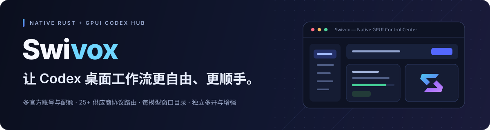

<p align="center">
  
</p>

<p align="center">
  <a href="README.md">中文</a> | English
</p>

<p align="center">
  <a href="https://github.com/aurorax-neo/swivox/releases"></a>
  <a href="https://github.com/aurorax-neo/swivox/stargazers"></a>
  <a href="LICENSE"></a>
  
  
</p>

**Swivox** is a GPU-accelerated native desktop control center for the OpenAI Codex / ChatGPT desktop application, built end-to-end with **Rust + GPUI** (~50 MB resident memory, zero WebView overhead). Through CDP and a local protocol conversion proxy, Swivox provides multi-account official OAuth management, 25+ API provider presets & aggregate routing, per-model context window catalogs, isolated multi-instance launching, MCP / Skills / session management, and runtime UI enhancements—without modifying the official app's `app.asar` or installation directory. All Swivox state (`~/.swivox`) and local ports (`58319–58321`) are cleanly namespaced and isolated.

## Key Features

| Area | Capabilities |
| --- | --- |
| **Official Accounts** | Multi-account OAuth PKCE browser sign-in, manual callback parsing, import from local `auth.json` / macOS Keychain / JSON, automatic token refresh, live 5h / weekly / monthly quota checks, one-click switching, and per-account third-party API provider binding |
| **API & Aggregate Providers** | 25 built-in provider presets, custom Responses / Chat Completions providers, Failover pools, Model aggregation, connectivity testing, and Provider Doctor diagnostics |
| **Codex Multi-Launch** | Launch isolated Codex instances for official accounts or API providers, each with dedicated configuration, SQLite sessions, and user-data directories |
| **Per-Model Context Catalogs** | Configure per-model context windows (`deepseek-v4-pro[1M]`), auto-compact percentages, and image policies with automatic native `model_catalog_json` generation |
| **MCP, Skills & Sessions** | Manage & sync `config.toml` MCP servers (with Claude Desktop JSON bulk import), install GitHub Skills, browse/delete local sessions with automatic backups, and repair stale session indexes |
| **Enhancements & Cache Cleaner** | Unlock in-client Plugin Market & custom model whitelists, cloud Whisper & offline SenseVoiceSmall dictation, Stepwise follow-up suggestions, custom image overlays, `window.swivox` user scripts, and whitelisted AI Agent cache cleanup |

## Quick Start

Download the latest installer from [GitHub Releases](https://github.com/aurorax-neo/swivox/releases):

- **macOS (Apple Silicon & Intel Universal)**: `Swivox-*-macos-universal.dmg`
- **Windows (x64)**: `Swivox-*-windows-x64-setup.exe` / `Swivox-*-windows-x64.zip`

1. Ensure the official Codex / ChatGPT desktop app is installed on your machine.
2. Open **Swivox**, sign in or import official accounts under **Official accounts**, or configure API providers under **Provider configuration**.
3. Click **Use** on any account or provider to apply immediately or apply & restart Codex.
4. Use the topbar **Launch Codex**, **Stop Codex**, or **Restart Codex** buttons for the main instance, or open **Codex multi-launch** to run multiple isolated instances side by side.

## Data Locations & Isolation

- Codex config & auth: `~/.codex/config.toml`, `~/.codex/auth.json` (overridable via `CODEX_HOME`)
- Codex local databases: `~/.codex/sqlite/*.db` (falls back to `~/.codex/state_5.sqlite`)
- **Swivox state & logs**: `~/.swivox/` (overridable via `SWIVOX_STATE_DIR`; stores `settings.json`, `official-accounts.json`, `ui-preferences.json`, `swivox.log`)
- **Swivox user scripts**: `~/.swivox/user_scripts/` and `~/.swivox/user_scripts.json`
- **Swivox multi-launch instances**: `~/.swivox/codex-multi/<instance-id>/`
- **Swivox default loopback ports**: Manager guard `58319`, Launcher guard `58320`, Protocol proxy `58321` (overridable via `SWIVOX_PROTOCOL_PROXY_PORT`)

## Development

```bash
# Run Rust test suites
cargo test -p swivox-backend --lib
cargo test -p swivox-gpui
cargo test -p swivox-launcher
cargo test -p swivox-data --lib

# Build release native desktop binaries
cargo build --release -p swivox-gpui --bins
```

If you edit shards under `assets/inject/renderer-inject/`, run `node scripts/assemble-renderer-inject.mjs` to reassemble `assets/inject/renderer-inject.js`.

## Credits & License Compliance

### 1. Credits
- **[BigPizzaV3/CodexPlusPlus](https://github.com/BigPizzaV3/CodexPlusPlus)** (`AGPL-3.0-only`): Upstream base repository from which the core launcher, protocol proxy, model catalog generator, and Codex renderer injection architecture originated.
- **[longbridge/gpui-kit](https://github.com/longbridge/gpui-kit)** & **[zed-industries/zed](https://github.com/zed-industries/zed)** (`Apache-2.0`): GPU-accelerated GPUI desktop framework and UI components.
- **[jlcodes99/cockpit-tools](https://github.com/jlcodes99/cockpit-tools)** (`CC-BY-NC-SA-4.0`): Reference for multi-account official OAuth PKCE sign-in, token refresh, live quota inspection, and global network proxy workflows.
- **[MeteorNOX/DeepSeek-Balance-Whale-Widget](https://github.com/MeteorNOX/DeepSeek-Balance-Whale-Widget)** (Code `MIT`) & **[Yang-huai406/Codex-Whale-Public](https://github.com/Yang-huai406/Codex-Whale-Public)**: Optional usage widget and character assets. See [Upstream LICENSE](assets/inject/upstream/whale-widget/LICENSE) and [PROVENANCE.md](assets/inject/upstream/whale-widget/PROVENANCE.md).

### 2. License & Disclaimer
- **Open-Source License**: Licensed under the [GNU Affero General Public License v3.0](LICENSE) (`AGPL-3.0-only`). See [THIRD_PARTY_NOTICES.md](THIRD_PARTY_NOTICES.md) for complete third-party notices.
- **Copyright**:
  - `Copyright (C) 2026 BigPizzaV3 and contributors` (Upstream code)
  - `Copyright (C) 2026 aurorax-neo` (Swivox GPUI native rewrite, multi-account architecture, and derivative additions)
- **Disclaimer**: OpenAI, ChatGPT, and Codex are trademarks of OpenAI, L.L.C. Swivox is not affiliated with or endorsed by OpenAI.

---

<p align="center">
  <br>
  <strong>Swivox</strong><br>
  <sub><a href="https://github.com/aurorax-neo/swivox">github.com/aurorax-neo/swivox</a> · <a href="LICENSE">AGPL-3.0-only</a> · <a href="THIRD_PARTY_NOTICES.md">Third-Party Notices</a></sub>
</p>
